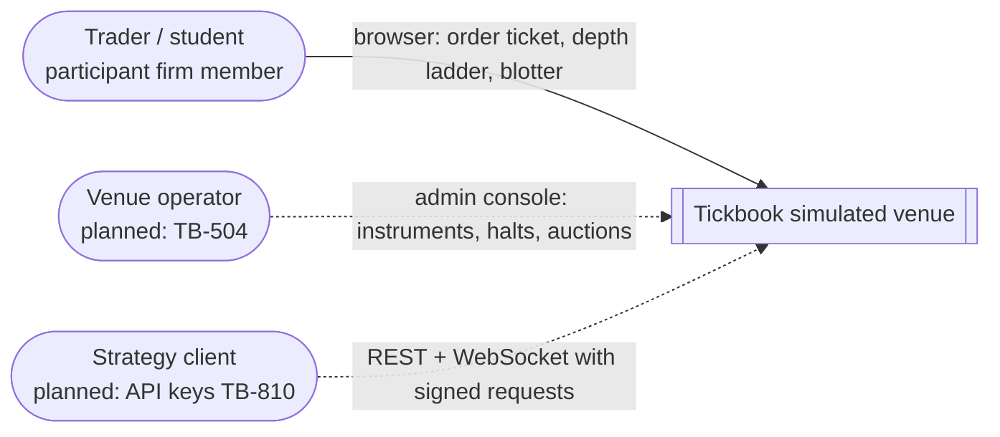
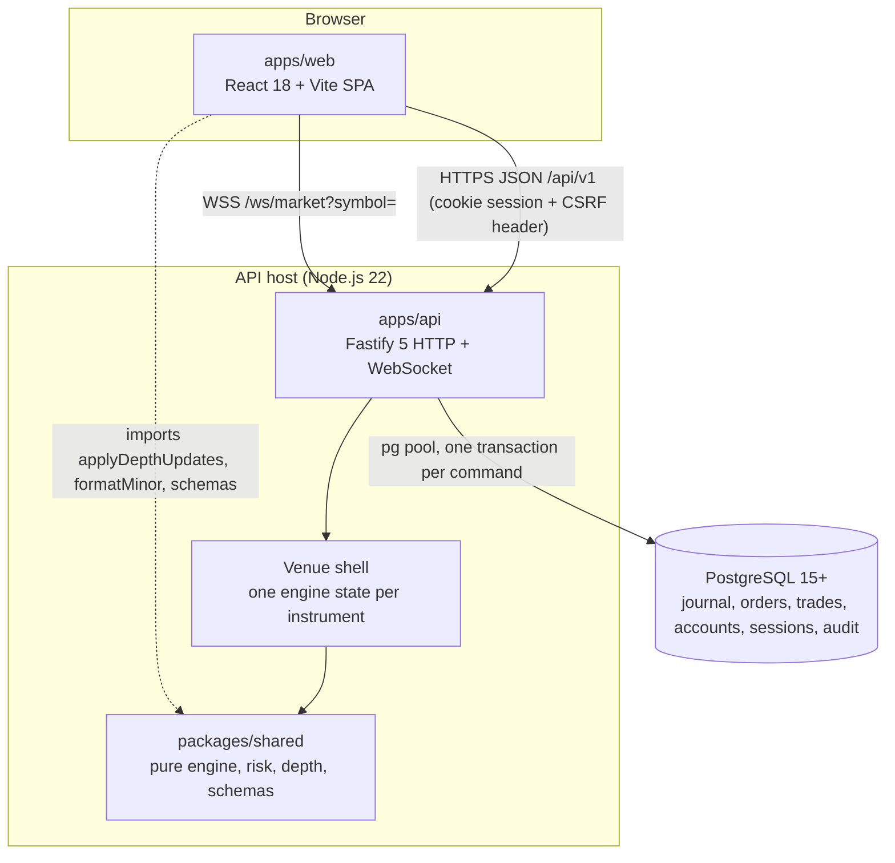
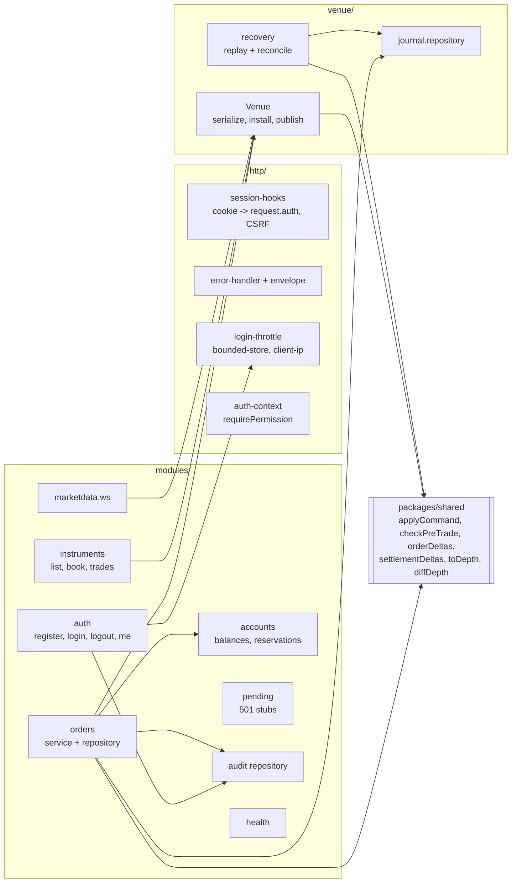
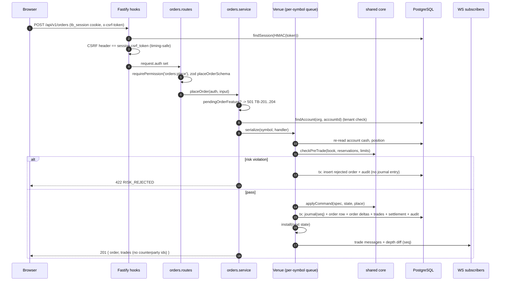

# Architecture overview

Tickbook is a **simulated** exchange: a central limit order book venue for education and strategy
testing. No real money moves, no external market data is consumed, and nothing calls out to the
internet at runtime. This document describes the structure of the system as built today and the
boundaries the planned work (see [../planning/roadmap.md](../planning/roadmap.md)) will respect.

## C4 level 1: system context

There are no external systems. Email-like notifications will go to a local `outbox` table
(TB-814); liquidity comes from in-process simulated market makers (seeded today, bots in TB-410).

## C4 level 2: containers

| Container         | Responsibility                                                                                  | Technology                                                    |
| ----------------- | ----------------------------------------------------------------------------------------------- | ------------------------------------------------------------- |
| `apps/web`        | Login/registration, trade screen, blotter, portfolio, planned-section placeholders              | React 18, React Router 6, plain CSS tokens                    |
| `apps/api`        | HTTP API, WebSocket market data, auth, persistence, venue shell                                 | Fastify 5, @fastify/cookie, @fastify/websocket, pg, zod, pino |
| `packages/shared` | Matching engine, order book, validation, lifecycle deltas, pre-trade risk, depth diffs, schemas | TypeScript, zod; no I/O                                       |
| PostgreSQL        | Durable source of truth: command journal, orders, trades, balances, sessions, audit             | Native server (no containers)                                 |

## C4 level 3: components of `apps/api`

## Module boundaries

- **`packages/shared` is the functional core** ([ADR-0003](../adr/0003-functional-core-imperative-shell.md)).
  Every function is pure: `applyCommand(spec, state, command) -> { state, events }`. It never reads the
  clock (timestamps travel inside commands), never generates ids (order ids arrive in the command), and
  never touches the database. This is what makes journal replay deterministic.
- **`apps/api/src/venue` is the imperative shell.** `Venue` owns exactly one mutable cell per instrument
  (the current `EngineState`), a promise chain that serializes commands per instrument
  ([ADR-0005](../adr/0005-single-writer-per-instrument.md)), and the market-data subscriber sets.
- **`apps/api/src/modules/<domain>`** each hold routes, an optional service, and repositories. Repositories
  take a `Queryable` so the same function runs on the pool or inside a transaction. Tenant scoping
  (`organization_id = $n`) is applied in repository functions, never left to callers.
- **`apps/web`** talks only to `/api/v1` and `/ws/market`. It imports pure helpers from `@tickbook/shared`
  (`applyDepthUpdates`, `formatMinor`, `parseMinor`, schema types) so client and server agree on depth
  reconstruction and money formatting.
- Cross-module calls inside the API go through exported functions only; no module reaches into another
  module's SQL.

## Request lifecycle: `POST /api/v1/orders`

Failure in the transaction rolls back and the venue keeps the previous state reference
([ADR-0010](../adr/0010-journal-then-install.md)); because the core is pure, "rollback" of the engine is
simply not assigning the new state.

Every request carries a request id (`x-request-id`, accepted from the client if it matches
`[A-Za-z0-9._-]{8,64}`, otherwise a UUID) that appears in logs and in `audit_log.request_id`. Errors
leave as the envelope `{ data: null, error: { code, message, details? } }`.

## Tenancy model

| Concept               | Scope                                                                                                                                                                         |
| --------------------- | ----------------------------------------------------------------------------------------------------------------------------------------------------------------------------- |
| Organization          | A participant firm (tenant). Users join via `memberships` with a role (`owner`, `trader`, `viewer`).                                                                          |
| Instruments and books | **Venue-wide.** All firms trade in the same books; that is the point of an exchange.                                                                                          |
| Accounts, positions   | Organization-scoped (`accounts.organization_id`). Looked up with `id AND organization_id`.                                                                                    |
| Orders                | Organization-scoped for reads and cancels; a foreign order id answers 404, not 403.                                                                                           |
| Trades                | Public tape shows price, size, aggressor side and time only. Execution reports show the caller's own fills; **counterparty firm, account and order ids are never disclosed**. |
| Market data           | Aggregated L2 (price, quantity, order count) — no order identities.                                                                                                           |

Venue operators (cross-firm surveillance, instrument admin) are a separate role family planned in
TB-504 and will not reuse firm roles.

## Deployment shape

One API process per venue today (the in-memory engine and in-process throttle are single-instance
by design; see [ADR-0013](../adr/0013-in-process-login-throttling.md) and TB-608 for the hot-standby
plan), behind nginx terminating TLS, with a native PostgreSQL. See
[../operations/deployment.md](../operations/deployment.md).
