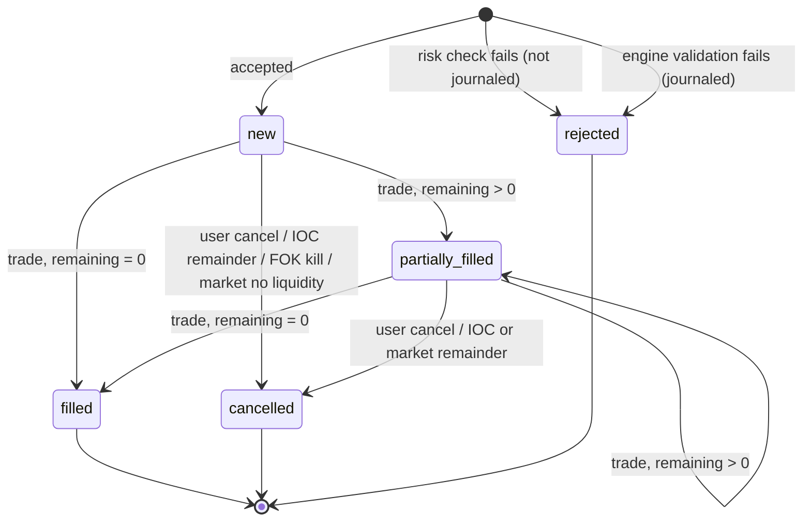
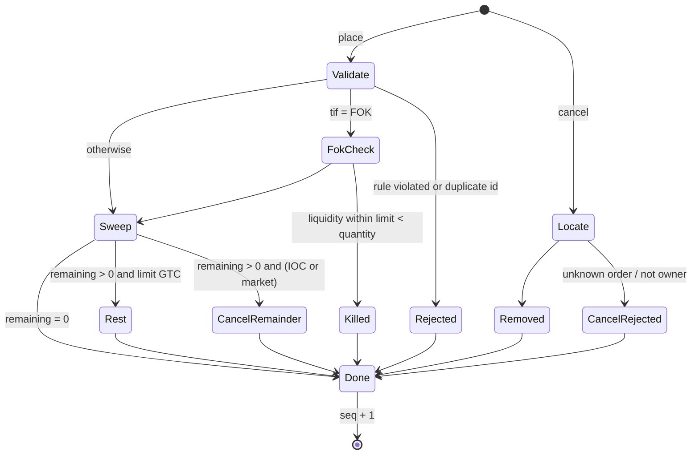
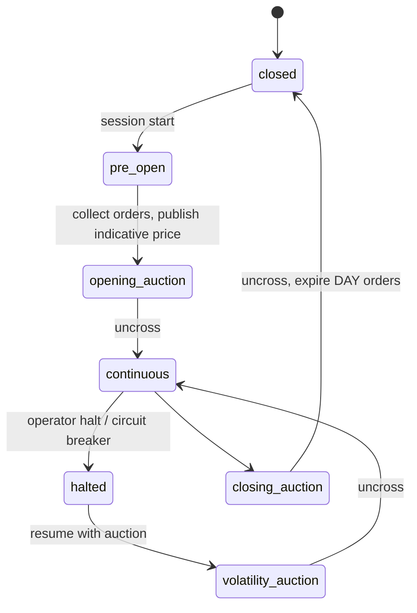

# System design

Design of the matching engine, its persistence and market data, as implemented in
`packages/shared/src/engine`, `packages/shared/src/marketdata`, `packages/shared/src/risk` and
`apps/api/src/venue`, plus the algorithms planned for later milestones. Tickbook is a simulated
venue: all liquidity and prices are in-house and fictional.

## 1. State machines

### 1.1 Order lifecycle (persisted `orders.status`)



`orderDeltas(events)` (pure) folds the engine events of one command into per-order changes
(filled quantity, filled notional, remaining, status, reasons) for the taker and every maker touched;
`applyOrderDeltas` writes them in the command's transaction.

Cancel reasons: `user_requested`, `ioc_remainder`, `fok_unfillable`, `market_no_liquidity`.
Reject reasons (engine): `invalid_quantity`, `quantity_not_lot_multiple`, `quantity_above_max`,
`price_required`, `price_not_allowed`, `invalid_price`, `price_not_tick_multiple`,
`invalid_tif_for_market`, `duplicate_order_id`. Risk reasons are stored as `risk:<rule>`.

### 1.2 Engine command processing



Every command — including rejections — increments `seq` by exactly one, so the journal is dense.

### 1.3 Instrument trading state (planned, TB-505/510/512/520)



Today `instruments.status` is `open | halted | closed` and only `open` accepts orders
(`INSTRUMENT_NOT_OPEN` otherwise). Session transitions will be journaled engine commands so
replay reproduces halts and auctions.

## 2. Sequence diagrams

### 2.1 Place order

```mermaid
sequenceDiagram
  participant C as Client
  participant S as orders.service
  participant V as Venue.serialize(symbol)
  participant E as shared engine
  participant DB as PostgreSQL
  C->>S: placeOrder(input)
  S->>S: pending feature? 501 / instrument open? / account in org?
  S->>V: enqueue handler (instrument section)
  V->>V: withAccountLock(account) (instrument first, then account)
  V->>DB: account cash, reserved_cash_minor, position (fresh)
  V->>E: checkPreTrade(order, book, reserved, exposure, limits)
  alt violations
    V->>DB: BEGIN; insert order(status=rejected); audit; COMMIT
    V-->>S: violations
    S-->>C: 422 RISK_REJECTED
  else ok
    loop until every maker in the dry run can settle
      V->>E: dry-run applyCommand(place)
      V->>DB: read maker cash/reservations/positions
      V->>E: applyCommand(cancel, reason insufficient_funds) for unfunded makers
    end
    V->>E: applyCommand(spec, state, {kind: place, order, ts})
    E-->>V: next state, events
    V->>DB: BEGIN; SELECT accounts FOR UPDATE (ids sorted)
    V->>DB: UPDATE accounts SET reserved += amt WHERE cash - reserved >= amt
    alt no row returned
      V->>DB: ROLLBACK; persist rejected order (risk:insufficient_buying_power)
      S-->>C: 422 RISK_REJECTED
    else reserved
      V->>DB: journal system cancels + place; orders; trades; settlement + reservation deltas; audit; COMMIT
      V->>V: install next; publish trade + depth messages
      S->>DB: read order view
      S-->>C: 201 {order, trades}
    end
  end
```

### 2.2 Cancel order

```mermaid
sequenceDiagram
  participant C as Client
  participant S as orders.service
  participant V as Venue.serialize(symbol)
  participant DB as PostgreSQL
  C->>S: DELETE /orders/:id
  S->>DB: findOrder(org, id) (404 if foreign or missing)
  S->>V: enqueue
  V->>V: findOrder in book (409 ORDER_NOT_OPEN if absent, nothing journaled)
  V->>V: applyCommand(cancel)
  V->>DB: BEGIN; journal(seq); apply deltas; audit; COMMIT
  V->>V: install; publish depth diff
  S-->>C: 200 order(status=cancelled)
```

### 2.3 Recovery at boot

```mermaid
sequenceDiagram
  participant M as index.ts
  participant R as recovery
  participant DB as PostgreSQL
  participant E as shared engine
  M->>R: recoverVenue(pool)
  loop each instrument
    R->>DB: SELECT seq, command FROM journal WHERE instrument_id ORDER BY seq
    R->>R: assert seq = 1..n (gap -> refuse to start)
    R->>E: replay(spec, commands)
    R->>DB: last trade price
    R->>R: venue.register(instrument, state, lastPrice)
  end
  M->>R: reconcile(pool, venue)
  R->>DB: open orders
  R-->>M: mismatches (logged; blocking in TB-603)
  M->>M: listen
```

### 2.4 Market-data subscription

```mermaid
sequenceDiagram
  participant B as Browser
  participant W as /ws/market
  participant V as Venue
  B->>W: upgrade ?symbol=TBK (session cookie)
  W->>W: no session or no marketdata:read -> close 4401; unknown symbol -> 4404
  W->>B: {type: snapshot, seq, bids, asks}
  W->>V: subscribe(symbol)
  V-->>B: {type: trade, seq, tradeId, price, quantity, aggressorSide, ts}
  V-->>B: {type: depth, seq, updates[]}
  B->>W: "snapshot" (resync on demand)
  W->>B: fresh snapshot
```

## 3. Core algorithms

Notation: L = price levels on a side, k = levels touched by a sweep, f = maker orders filled,
n = resting orders, d = published depth, N = journal length.

### 3.1 Book structure and insertion

Bids and asks are arrays of immutable `PriceLevel { price, orders[], total }`, bids descending and
asks ascending. `findLevelIndex` binary-searches with a side-aware comparator: **O(log L)**.
`insertResting` copies the level array and either appends to the level's FIFO queue (copying that
level's order array) or splices in a new level: **O(log L + L)** time, O(L) allocation; untouched
levels are shared with the previous book version.

### 3.2 Sweep (matching)

```
sweep(book, taker):
  levels = opposite side, best first
  limit = null for market, else taker.price
  i = 0
  while remaining > 0 and i < len(levels) and crosses(taker.side, limit, levels[i].price):
     consume levels[i] FIFO: each maker fills min(remaining, maker.remaining) at levels[i].price
     if level partially consumed: keep residual level, stop
     i += 1
  new side = [residual?] + levels[i(+1)..]   // slice shares untouched levels
```

Time **O(k + f)** plus O(L − k) for the slice copy; trades are emitted in priority order with dense
`tradeId = lastTradeId + 1, ...`. The taker's remainder then rests (limit GTC), or is cancelled
(IOC → `ioc_remainder`, market → `market_no_liquidity`).

### 3.3 FOK pre-check

`availableLiquidity(book, side, limit, needed)` walks crossing levels summing `level.total` and
stops as soon as the sum reaches `needed`: **O(k)**, no allocation. If short, the order is killed
with no trades and the book reference is returned unchanged.

### 3.4 Cancel

`findOrder` scans both sides: **O(n)** ([ADR-0009](../adr/0009-linear-scan-order-lookup.md));
`removeAt` copies one level's order array and the side array: O(L + level size). TB-114 replaces
the scan with an index for O(log L).

### 3.5 Depth snapshot and diff

`toDepth(book, d)` slices and aggregates: **O(d)**. `diffDepth(prev, next)` builds price maps per
side and emits removals (quantity 0), additions and changes: **O(d)**. `applyDepthUpdates`
re-sorts at most 2d levels: O(d log d). Correctness: property test over random engine evolutions
asserts `applyDepthUpdates(prev, diffDepth(prev, next)) == next`.

### 3.6 Pre-trade risk

`checkPreTrade` computes order notional (limit: price × qty; market buy:
`estimateSweepNotional`, O(k)), then checks fat-finger band
(`|price − ref| × 10,000 > ref × bandBps`), max notional, buying power
(`notional > cash − reserved_cash_minor`), position limit (`position + open buy qty + qty > maxPosition`)
and, for sells, available position (`qty > position − open sell qty`; no short selling yet).

The check is advisory; the **durable gate** is the conditional reservation (ADR-0019):
`UPDATE accounts SET reserved_cash_minor = reserved_cash_minor + $amt WHERE id = $1 AND
cash_minor − reserved_cash_minor >= $amt RETURNING id`, executed in the order's transaction. No row
back means the order is rejected with `insufficient_buying_power`, so two orders on different
instruments can never commit the same cash. `reservationDeltas` (pure, in `packages/shared`) then
keeps the invariant **reserved = Σ price × remaining over resting buys**: an incoming buy releases its
up-front reservation and re-reserves only what rests; a maker buy fill releases price × qty as the
cash is spent; a cancel (user, IOC remainder, or `insufficient_funds`) releases price × remaining.
`reconcile()` verifies the invariant against the replayed books at boot.

### 3.6.1 Unfunded resting makers

Before matching, the incoming order is dry-run against the book (pure, so free of side effects).
For every maker it would hit, the maker account's coverable cash (`min(cash, reserved)`) or
position is compared with what the dry run would settle. Makers that cannot settle (only possible
after out-of-band balance edits; a future withdrawal flow, TB-305, must go through reservations)
are removed with a journaled `cancel` command carrying `reason: 'insufficient_funds'`, and the dry
run repeats (bounded: each round removes at least one order). The cancels and the order are written
in the same transaction, so either all are durable and installed, or none are.

### 3.7 Replay

`replay(spec, commands, from)` is `commands.reduce(applyCommand)`: **O(N × per-command cost)**.
Snapshots (TB-602) will make boot O(snapshot load + commands since snapshot).

### 3.8 Planned: auction uncrossing (TB-522)

For candidate prices P (all limit prices in the auction book), compute cumulative buy demand
B(p) = Σ qty of bids with price ≥ p (plus market bids) and sell supply S(p) = Σ asks with price ≤ p.
Executable volume V(p) = min(B(p), S(p)). Select the price by successive tie-breakers:

1. maximum V(p);
2. minimum surplus |B(p) − S(p)|;
3. market pressure: if all remaining candidates have buy surplus choose the highest price, if sell
   surplus the lowest;
4. closest to the reference price (last trade / previous close).

With prices sorted once and prefix sums, evaluation is **O(P log P)**. Allocation (TB-523) fills
in price-time priority at the single uncrossing price; residual surplus rests into continuous
trading. Property tests (TB-524) compare against brute force over all candidate prices.

### 3.9 Planned: stop trigger cascade (TB-201)

Stops live in a separate trigger book keyed by stop price (buy stops ascending, sell stops
descending). After each command that produces trades, the engine checks the last trade price
against the best trigger; triggered stops are converted to market (stop) or limit (stop-limit)
commands and processed **within the same engine command**, in trigger-price then sequence order,
looping until no further triggers fire. A per-command cascade cap protects against runaway loops,
and all derived orders are part of the same journal entry so replay is identical.

### 3.10 Planned: iceberg replenishment (TB-202)

An iceberg rests with `display ≤ total`. Only the displayed slice counts in L2 depth. When the
displayed slice is fully filled and hidden quantity remains, a new slice is placed at the **back**
of the level's queue with a new priority key (the current command's seq), as on most venues.
Hidden quantity is matched only after displayed quantity at the same price.

## 4. Concurrency and consistency strategy

| Concern                       | Strategy                                                                                                                                                                                                                          |
| ----------------------------- | --------------------------------------------------------------------------------------------------------------------------------------------------------------------------------------------------------------------------------- |
| Ordering within an instrument | Promise-chain single writer (`Venue.serialize`); dense `seq` in journal primary key `(instrument_id, seq)`                                                                                                                        |
| Parallelism                   | Independent instruments run concurrently on the event loop                                                                                                                                                                        |
| Atomicity                     | One transaction per command: journal, orders, deltas, trades, settlement, audit                                                                                                                                                   |
| Rollback                      | State installed only after commit; pure core means nothing to undo                                                                                                                                                                |
| Cross-instrument buying power | Durable conditional reservation in `accounts.reserved_cash_minor` + per-account in-process mutex; lock order instrument → account; touched account rows locked `FOR UPDATE` in id order to rule out database deadlocks (ADR-0019) |
| Position updates              | UPDATE-then-INSERT (an `INSERT ... ON CONFLICT` would CHECK the negative proposed row first)                                                                                                                                      |
| Migrations                    | `pg_advisory_lock(41060001)`, one transaction per file, checksum verification                                                                                                                                                     |
| Multi-instance                | Not supported yet: engine state and login throttle are per process (TB-608, TB-813)                                                                                                                                               |
| Market data ordering          | Messages published after install, in event order, tagged with engine `seq`                                                                                                                                                        |

## 5. Failure modes

| Failure                                     | Detection                        | Effect / handling                                                  |
| ------------------------------------------- | -------------------------------- | ------------------------------------------------------------------ |
| Database unavailable                        | `/ready` 503; transaction throws | Commands fail with 500; state unchanged; no market data emitted    |
| Unique violation (`clientOrderId` reused)   | `23505`                          | 409 `DUPLICATE_CLIENT_ORDER_ID`; state and seq unchanged           |
| Cash/position CHECK violation at settlement | `23514` on known constraints     | 409 `SETTLEMENT_CONFLICT`; client retries                          |
| Database deadlock (defensive)               | `40P01`                          | 409 `SETTLEMENT_CONFLICT`; nothing journaled or installed          |
| Resting maker can no longer settle          | Dry-run funding check            | Maker cancelled `insufficient_funds` (journaled); order proceeds   |
| Other CHECK violation                       | `23514` on other constraint      | 500 and logged (programming error)                                 |
| Crash after commit before install           | Boot replay                      | Command is in the book after restart; client can query by order id |
| Journal gap / corruption                    | `recoverVenue`                   | Refuse to start                                                    |
| Book vs orders mismatch                     | `reconcile` at boot              | Warning today; block trading in TB-603                             |
| Slow WebSocket consumer                     | `bufferedAmount > 1 MB`          | Socket closed with 1013; client reconnects and resnapshots         |
| Subscriber callback throws                  | try/catch in `publish`           | Ignored; matching and other subscribers unaffected                 |
| Engine refuses a cancel the book allowed    | Missing `cancelled` event        | 500 `ENGINE_INCONSISTENT` (should be impossible; guarded)          |
| Login flood / spraying                      | Throttle counters                | 429 with `Retry-After`; store bounded, never global lockout        |
