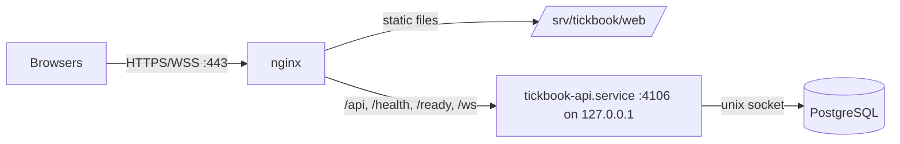

# Deployment

Tickbook deploys as plain processes on one Linux VM or bare-metal host: Node.js 22 running the API
under systemd, nginx serving the built SPA and proxying the API and WebSocket, and a natively
installed PostgreSQL (15+). There are no containers and no hosted services.

## Topology and the single-instance constraint



Run **exactly one** API process. Two reasons:

1. Matching is single-writer per instrument (ADR-0003): the order book lives in the API process and
   every command for an instrument is serialized through one in-memory queue. A second process would
   hold a divergent book and the journal's unique `(instrument_id, seq)` key would reject its writes.
2. Login and registration throttle counters are in process memory. More instances would multiply the
   limits; they must move to Postgres first (TB-813).

Scale vertically (CPU clock speed matters more than cores). Horizontal options are on the roadmap:
worker threads per instrument group (TB-607) and a hot standby that replays the journal (TB-608).

## Host preparation (Debian/Ubuntu example)

```bash
sudo apt-get install -y nginx postgresql
# Node.js 22 from your distribution or nodejs.org binaries
sudo useradd --system --home /srv/tickbook --shell /usr/sbin/nologin tickbook
sudo -u postgres createuser tickbook
sudo -u postgres createdb -O tickbook tickbook
sudo install -d -o tickbook -g tickbook -m 750 /srv/tickbook /var/backups/tickbook
sudo install -d -m 750 /etc/tickbook
```

`/etc/tickbook/tickbook.env` (mode 0640, owner root:tickbook):

```ini
NODE_ENV=production
API_HOST=127.0.0.1
API_PORT=4106
APP_ORIGIN=https://tickbook.example.internal
DATABASE_URL=postgres:///tickbook?host=/var/run/postgresql
SESSION_SECRET=<64 hex chars from: openssl rand -hex 32>
SESSION_TTL_HOURS=12
LOGIN_RATE_LIMIT_PER_MINUTE=30
REGISTER_RATE_LIMIT_PER_HOUR=5
# nginx runs on the same host; trust only it. "true" is rejected at startup.
TRUST_PROXY=127.0.0.1
LOG_LEVEL=info
```

## systemd unit

`/etc/systemd/system/tickbook-api.service`:

```ini
[Unit]
Description=Tickbook simulated exchange API
After=network.target postgresql.service
Requires=postgresql.service

[Service]
User=tickbook
Group=tickbook
WorkingDirectory=/srv/tickbook/current
EnvironmentFile=/etc/tickbook/tickbook.env
ExecStartPre=/usr/bin/node apps/api/dist/db/cli.js migrate
ExecStart=/usr/bin/node apps/api/dist/index.js
Restart=on-failure
RestartSec=2
# Recovery replays the journal; allow time on large journals until snapshots land (TB-602).
TimeoutStartSec=120
KillSignal=SIGTERM
NoNewPrivileges=true
ProtectSystem=strict
ProtectHome=true
PrivateTmp=true
ReadWritePaths=/srv/tickbook

[Install]
WantedBy=multi-user.target
```

The API handles SIGTERM by closing the HTTP server (in-flight commands finish) and the pool.

## nginx

```nginx
server {
  listen 443 ssl http2;
  server_name tickbook.example.internal;
  ssl_certificate     /etc/ssl/tickbook/fullchain.pem;
  ssl_certificate_key /etc/ssl/tickbook/privkey.pem;

  root /srv/tickbook/current/apps/web/dist;
  add_header Content-Security-Policy "default-src 'self'; connect-src 'self' wss:; img-src 'self' data:; style-src 'self'; frame-ancestors 'none'" always;
  add_header Strict-Transport-Security "max-age=31536000" always;

  location / { try_files $uri /index.html; }

  location ~ ^/(api|health|ready)(/|$) {
    proxy_pass http://127.0.0.1:4106;
    proxy_set_header Host $host;
    proxy_set_header X-Forwarded-For $remote_addr;   # overwrite, never append client values
    proxy_set_header X-Forwarded-Proto $scheme;
    proxy_set_header X-Request-Id $request_id;
  }

  location /ws/ {
    proxy_pass http://127.0.0.1:4106;
    proxy_http_version 1.1;
    proxy_set_header Upgrade $http_upgrade;
    proxy_set_header Connection "upgrade";
    proxy_set_header Host $host;
    proxy_set_header X-Forwarded-For $remote_addr;
    proxy_read_timeout 1h;
  }
}
```

Setting `X-Forwarded-For $remote_addr` (rather than `$proxy_add_x_forwarded_for`) plus
`TRUST_PROXY=127.0.0.1` means clients cannot inject addresses into the throttling key.

## Release

Releases are immutable directories; `current` is a symlink.

```bash
REL=/srv/tickbook/releases/$(date -u +%Y%m%d%H%M%S)
git clone --depth 1 --branch v0.1.0 https://github.com/mayur19/tickbook "$REL"
cd "$REL" && npm ci --no-audit --no-fund && npm run build
pg_dump --format=custom --file=/var/backups/tickbook/pre-release-$(basename "$REL").dump tickbook
ln -sfn "$REL" /srv/tickbook/current
sudo systemctl restart tickbook-api      # ExecStartPre applies migrations
curl -fsS https://tickbook.example.internal/ready
```

Restarting the API pauses matching for the recovery time (journal replay, roughly 50k commands per
second today). Announce a maintenance window for large journals.

## Rollback

Migrations are forward-only. Every migration must be backward compatible with the previous release
(add columns nullable or with defaults, never drop or rename in the same release that stops using
them). Rollback is therefore:

```bash
ln -sfn /srv/tickbook/releases/<previous> /srv/tickbook/current
sudo systemctl restart tickbook-api
```

If a release must be undone together with its data changes, restore the pre-release dump
(see [runbook.md](runbook.md#restore)). Never edit an applied migration: the runner verifies
checksums and refuses to start.

## Post-deploy checks

- `journalctl -u tickbook-api` shows `order books recovered from journal` and no
  `journal and order table disagree` warning.
- `/ready` returns `{"status":"ready","instruments":N}`.
- Sign in, open the Trade screen, confirm the live indicator is green (WebSocket through nginx).
