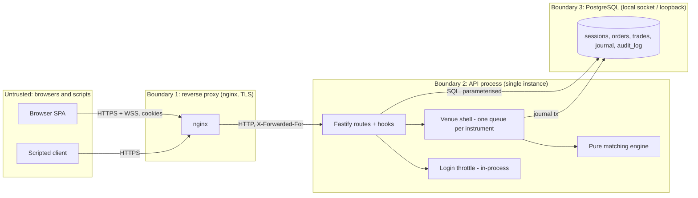

# Threat model

Scope: the Tickbook API (Fastify), the matching venue shell and pure engine, the PostgreSQL
database, the market-data WebSocket and the React SPA, as deployed per
[../operations/deployment.md](../operations/deployment.md). Tickbook is a **simulated venue**: there
is no real money, but the threats still matter because firms compete on a shared book (fairness,
confidentiality of order flow), and accounts hold credentials.

Method: STRIDE per component, then mitigations mapped to OWASP ASVS 4.0.3. Status reflects the code
in this repository (`implemented`) or a backlog ticket (`planned`).

## Assets

| Asset                         | Why it matters                                                            |
| ----------------------------- | ------------------------------------------------------------------------- |
| Credentials and sessions      | Account takeover lets an attacker trade and see a firm's orders           |
| Firm order flow and positions | Confidential; leaking it lets competitors front-run in the simulation     |
| Journal (command log)         | Source of truth for the book; tampering rewrites market history on replay |
| Balances and positions        | Integrity of the simulation, leaderboard/education outcomes               |
| Audit log                     | Accountability for logins, orders and cancels                             |
| Availability of matching      | A stalled instrument queue halts the market for everyone                  |

## Trust boundaries

Boundary 1 terminates TLS and is the only hop allowed to set `X-Forwarded-For`. Boundary 2 trusts
proxy headers only from addresses configured in `TRUST_PROXY`. Boundary 3 is reachable only from the
API host.

## STRIDE by component

### Authentication and sessions

| Threat | Scenario                                          | Mitigation                                                                                                                                                                                                                                                       | Status           |
| ------ | ------------------------------------------------- | ---------------------------------------------------------------------------------------------------------------------------------------------------------------------------------------------------------------------------------------------------------------- | ---------------- |
| S-1    | Credential stuffing / online guessing of one user | Per-email failure counter with progressive exponential backoff: 5 free failures, then 1s, 2s, 4s ... capped at 15 minutes; history decays after 15 minutes without attempts; a successful login resets it                                                        | implemented      |
| S-2    | Password spraying from one host across many users | Per-normalised-IP attempt limit (`LOGIN_RATE_LIMIT_PER_MINUTE`, default 30) counted across all emails, independent of the per-email counter                                                                                                                      | implemented      |
| S-3    | Email enumeration / key-space flooding            | Per-IP cap on distinct emails per window (10/min); generic `INVALID_CREDENTIALS`; scrypt verification against a dummy hash when the user does not exist to equalise timing                                                                                       | implemented      |
| S-4    | Parallel login burst slips past the check         | `reserve()` is synchronous: the attempt is counted (as a failure) before any `await`, and released only on success. A test fires 12 concurrent bad logins and asserts exactly the allowance gets through                                                         | implemented      |
| S-5    | Throttle store exhaustion locks everyone out      | Bounded store (10,000 keys per counter). When full: a resumable cursor sweeps expired entries across the whole map; if every entry is still active, the entry with the least time left is evicted and a warning is logged. New keys are never blocked by default | implemented      |
| S-6    | IP rotation inside one IPv6 allocation            | IPv4-mapped IPv6 (`::ffff:a.b.c.d`) is normalised to IPv4; other IPv6 addresses collapse to their /64 prefix                                                                                                                                                     | implemented      |
| S-7    | Spoofed `X-Forwarded-For` bypasses IP limits      | `TRUST_PROXY` defaults to `false`; accepts a hop count or a comma-separated IP/CIDR list; the value `true` is rejected at startup; production refuses to start unless `TRUST_PROXY` is set explicitly                                                            | implemented      |
| S-8    | Session token theft from a database dump          | Only `HMAC-SHA256(token, SESSION_SECRET)` is stored; tokens are 256-bit random; cookies HttpOnly, SameSite=Lax, Secure in production; server-side expiry (`SESSION_TTL_HOURS`)                                                                                   | implemented      |
| S-9    | Account enumeration via registration              | Registration always answers `202` with the same body, hashes a password on both paths, never issues a session, and is rate-limited per IP (`REGISTER_RATE_LIMIT_PER_HOUR`). Email-verified signup through the local outbox is planned                            | partial (TB-812) |
| S-10   | Session fixation / privilege change               | New random token on every login; rotation on role change and a session list/revoke UI are planned                                                                                                                                                                | planned (TB-804) |
| S-11   | Single-factor accounts                            | Optional TOTP                                                                                                                                                                                                                                                    | planned (TB-811) |

**Multi-instance limitation.** All throttle counters live in the API process memory. Running more
than one API instance multiplies every limit by the instance count and resets counters on restart.
Before scaling out, the counters **must** move to Postgres (TB-813). The single-writer matching
design already requires one API instance today (ADR-0003), so this is documented rather than
enforced.

### Order entry and matching

| Threat | Scenario                                                  | Mitigation                                                                                                                                                                                                                                                                                                                                                                                                               | Status               |
| ------ | --------------------------------------------------------- | ------------------------------------------------------------------------------------------------------------------------------------------------------------------------------------------------------------------------------------------------------------------------------------------------------------------------------------------------------------------------------------------------------------------------ | -------------------- |
| T-1    | Placing/cancelling orders for another firm's account      | Account lookup is scoped by `organization_id`; cancel checks org ownership in SQL and account ownership inside the engine; foreign resources answer `404`                                                                                                                                                                                                                                                                | implemented          |
| T-2    | CSRF from a malicious site using the victim's cookie      | Double-submit: `X-CSRF-Token` must equal the session's token (constant-time compare) on every mutating request with a session; SameSite=Lax as a second layer                                                                                                                                                                                                                                                            | implemented          |
| I-1    | Learning a counterparty's identity from execution reports | Place-order responses return only `tradeId`, `price`, `quantity`, `liquidity`; the public tape and WebSocket carry no account or order IDs                                                                                                                                                                                                                                                                               | implemented          |
| I-2    | Reading other firms' orders                               | Order queries filter by organization; depth is aggregated per price level (no order IDs)                                                                                                                                                                                                                                                                                                                                 | implemented          |
| T-3    | Fat-finger or runaway orders distort the shared book      | Pre-trade checks inside the serialized section: price band, max notional, buying power including resting buys, position limits, no short selling                                                                                                                                                                                                                                                                         | implemented          |
| D-1    | Flooding one instrument's queue                           | Body limit 64 KiB; per-account message rate limits and kill switch planned                                                                                                                                                                                                                                                                                                                                               | planned (TB-321)     |
| T-4    | Race between instruments double-spends cash               | Durable `accounts.reserved_cash_minor`: a buy reserves its worst-case notional with a conditional `UPDATE ... WHERE cash - reserved >= amount` inside the instrument section plus a per-account mutex (lock order instrument then account); touched accounts are row-locked in id order; fills, cancels and IOC remainders release. Deadlocks (`40P01`) map to retryable `SETTLEMENT_CONFLICT` and no state is installed | implemented (TB-306) |
| T-4b   | Out-of-band balance edits leave resting makers unfunded   | A resting maker that can no longer settle is cancelled with reason `insufficient_funds` via a journaled engine cancel command; reconciliation also compares reserved cash with the books                                                                                                                                                                                                                                 | implemented (TB-306) |
| R-1    | Disputing an order or cancel                              | Audit rows for `order.placed`, `order.cancelled`, `order.risk_rejected` with request IDs; every engine command is journaled with its timestamp                                                                                                                                                                                                                                                                           | implemented          |

### Journal and database

| Threat | Scenario                                          | Mitigation                                                                                                                                                      | Status           |
| ------ | ------------------------------------------------- | --------------------------------------------------------------------------------------------------------------------------------------------------------------- | ---------------- |
| T-5    | Editing or deleting journal rows rewrites history | Recovery refuses to start on a sequence gap; boot reconciliation compares the replayed books with open orders and logs mismatches. Hash-chained entries planned | partial (TB-605) |
| T-6    | Reconciliation mismatch ignored in production     | Today a warning; blocking trading on mismatch is planned                                                                                                        | planned (TB-603) |
| T-7    | SQL injection                                     | Parameterised queries only; zod validation of every input; symbols restricted to `[A-Z0-9.]{1,12}`                                                              | implemented      |
| I-3    | Backup files leak credentials                     | Password hashes are scrypt (N=16384, r=8, p=1); session tokens are HMAC-hashed; backups stored with 0600 permissions per runbook                                | implemented      |
| T-8    | Editing an applied migration                      | Migration runner verifies SHA-256 checksums and aborts on mismatch                                                                                              | implemented      |

### Market-data WebSocket

| Threat | Scenario                             | Mitigation                                                                                                   | Status           |
| ------ | ------------------------------------ | ------------------------------------------------------------------------------------------------------------ | ---------------- |
| S-12   | Anonymous scraping of the book       | Session cookie and `marketdata:read` required; otherwise closed with code 4401                               | implemented      |
| D-2    | Slow consumer exhausts server memory | Connection closed with 1013 when more than 1 MB is buffered; inbound frames capped at 4 KiB                  | implemented      |
| D-3    | Subscriber exception stalls matching | Publishing happens after commit; listener errors are caught and never affect the engine or other subscribers | implemented      |
| D-4    | Thousands of subscribers per symbol  | Conflation and per-connection send budgets planned                                                           | planned (TB-407) |

### Web SPA

| Threat | Scenario     | Mitigation                                                                                                           | Status      |
| ------ | ------------ | -------------------------------------------------------------------------------------------------------------------- | ----------- |
| T-9    | XSS          | React escaping, no `dangerouslySetInnerHTML`, no third-party scripts or CDNs; `X-Content-Type-Options: nosniff`      | implemented |
| T-10   | Clickjacking | `X-Frame-Options: DENY`; `Referrer-Policy: no-referrer`; a full CSP header via nginx is part of the deployment guide | implemented |

## OWASP ASVS 4.0.3 mapping (level 2 subset)

| ASVS     | Requirement                              | How Tickbook meets it                                      | Status            |
| -------- | ---------------------------------------- | ---------------------------------------------------------- | ----------------- |
| V2.1.1   | Passwords at least 12 characters         | `passwordSchema` min 12, max 128                           | implemented       |
| V2.2.1   | Anti-automation controls                 | Per-email backoff, per-IP limits, distinct-email cap       | implemented       |
| V2.4.1   | Passwords stored with an approved KDF    | scrypt with random 16-byte salt, constant-time verify      | implemented       |
| V2.5.x   | Credential recovery                      | Password reset via local outbox                            | planned (TB-803)  |
| V2.8.x   | Multi-factor                             | TOTP                                                       | planned (TB-811)  |
| V3.2.1   | New session token on authentication      | Fresh 256-bit token per login                              | implemented       |
| V3.3.1   | Logout invalidates the session           | Session row deleted, cookies cleared                       | implemented       |
| V3.4.1-3 | Cookie attributes                        | HttpOnly, Secure (production), SameSite=Lax, Path=/        | implemented       |
| V3.5.x   | Token-based sessions for API clients     | HMAC-signed API keys                                       | planned (TB-810)  |
| V4.1.1   | Access control enforced server-side      | `requirePermission` on every route; tenancy in every query | implemented       |
| V4.2.2   | CSRF protection                          | Double-submit header check                                 | implemented       |
| V5.1.3   | Input validation with allow lists        | zod schemas at every boundary                              | implemented       |
| V5.3.4   | Parameterised queries                    | `pg` placeholders only                                     | implemented       |
| V7.1.1   | No credentials or session tokens in logs | pino redaction of cookie, authorization and CSRF headers   | implemented       |
| V7.4.1   | Generic error messages                   | Central handler returns `INTERNAL` without internals       | implemented       |
| V8.3.4   | Sensitive data identified and protected  | Counterparty anonymity; firm-scoped order data             | implemented       |
| V9.1.1   | TLS for all client connections           | nginx terminates TLS (deployment guide)                    | implemented (ops) |
| V11.1.4  | Anti-automation on business flows        | Per-account order rate limits                              | planned (TB-321)  |
| V13.1.x  | API security                             | Body limits, envelope, request IDs                         | implemented       |
| V14.4.x  | Security headers                         | nosniff, frame deny, referrer policy; CSP via nginx        | implemented       |

## Residual risks

- In-process throttle counters reset on restart and do not work across instances (TB-813).
- Journal integrity relies on database permissions until the hash chain lands (TB-605).
- Out-of-band balance edits (manual SQL) are absorbed by `insufficient_funds` cancels rather than prevented; database permissions remain the control.
- No per-account order rate limit yet; a compromised trader account can flood one queue (TB-321).
- Registration still creates the firm immediately; verified signup is pending (TB-812).
