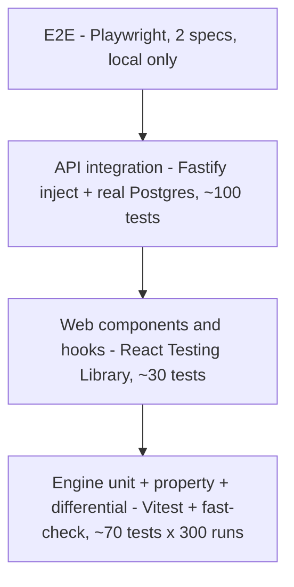

# Test strategy

The hardest code in Tickbook is the matching engine, so most of the test effort sits in
`packages/shared`, where the engine is a pure function and can be tested exhaustively without I/O.
The API layer is tested against a **real PostgreSQL database**, never mocks, because the journal,
settlement and recovery guarantees live in transactions.

## Pyramid



## What is tested where

| Layer               | Location                             | Tooling                              | Focus                                                                                                                                                                                                                                                                                |
| ------------------- | ------------------------------------ | ------------------------------------ | ------------------------------------------------------------------------------------------------------------------------------------------------------------------------------------------------------------------------------------------------------------------------------------ |
| Engine unit         | `packages/shared/test/*.test.ts`     | Vitest                               | Book structure, validation rules, every order type and TIF scenario, cancellation, rejection, lifecycle deltas, settlement deltas, depth diff, risk rules, money formatting, schemas, RBAC                                                                                           |
| Engine properties   | `engine.property.test.ts`            | fast-check (300 runs each)           | Book never crossed or malformed; quantity conservation per order; no trade through a limit; trades at maker price; FOK all-or-nothing; IOC/market never rest; dense trade IDs; replay determinism from any cut point                                                                 |
| Differential        | `reference-model.ts`                 | fast-check                           | The engine's trades and resting orders equal those of a deliberately naive re-sort-everything matcher on random command streams                                                                                                                                                      |
| Depth round trip    | `depth.test.ts`                      | fast-check                           | `apply(prev, diff(prev, next)) == next` for every engine evolution and depth                                                                                                                                                                                                         |
| API integration     | `apps/api/test/*.test.ts`            | Vitest + `app.inject`, real Postgres | Auth flows, CSRF, throttling (including parallel bad logins), registration non-enumeration, order placement and matching, settlement, risk rejections, tenancy, 501 stubs, journal recovery equality, reconciliation, migration checksums, WebSocket snapshot/depth/trade sequencing |
| Config and throttle | `config.test.ts`, `throttle.test.ts` | Vitest                               | `TRUST_PROXY` parsing and production requirement, IP normalisation, backoff curve, bounded-store sweep and eviction                                                                                                                                                                  |
| Web                 | `apps/web/test`                      | Vitest + jsdom + RTL                 | Depth ladder ordering and click-to-price, order ticket validation and submission in minor units, orders table, tape, market-state reducer, WebSocket hook reconnect rules, session provider, API client                                                                              |
| End to end          | `e2e/specs`                          | Playwright (Chromium)                | Sign in, live depth, place and cancel a resting order through the UI; planned sections visible                                                                                                                                                                                       |
| Benchmark           | `packages/shared/bench`              | `npm run bench -w @tickbook/shared`  | In-memory engine throughput and latency percentiles (not a pass/fail test)                                                                                                                                                                                                           |

## Acceptance test matrix

| Requirement area                   | Test(s)                                                                                  |
| ---------------------------------- | ---------------------------------------------------------------------------------------- |
| price-time priority                | `engine.test.ts` "honours price priority, then time priority"; differential property     |
| trade at resting price             | `engine.test.ts` price improvement; property "never trades through a limit"              |
| IOC and FOK                        | `engine.test.ts` IOC/FOK suites; property "FOK orders fill completely or not at all"     |
| market orders                      | `engine.test.ts` market suite; `orders.http.test.ts` "executes market orders"            |
| cancel                             | `engine.test.ts` cancellation; `orders.http.test.ts` cancelling suite                    |
| journal and deterministic recovery | `engine.test.ts` determinism; property replay; `recovery.db.test.ts` restart equality    |
| serialized sequencing              | `orders.http.test.ts` "serializes concurrent orders"                                     |
| pre-trade risk                     | `risk.test.ts`; `orders.http.test.ts` risk rejections and open-buy reservation           |
| settlement                         | `lifecycle.test.ts` settlement deltas; `orders.http.test.ts` cash/positions              |
| L2 snapshot and incremental stream | `depth.test.ts` round trip; `ws.test.ts`                                                 |
| auth, sessions, CSRF               | `auth.http.test.ts`                                                                      |
| Login throttling                   | `throttle.test.ts`; `auth.http.test.ts` backoff, parallel logins, spraying               |
| Counterparty anonymity             | `orders.http.test.ts` asserts the maker account ID never appears in the taker's response |
| Pending surface returns 501        | `pending.http.test.ts` (every route in `PENDING_ROUTES`)                                 |

Requirement IDs are defined in [../product/requirements.md](../product/requirements.md); the
full FR-to-test mapping lives in [../product/requirements-traceability.md](../product/requirements-traceability.md).

## Coverage thresholds

Thresholds apply to implemented code only (seed scripts, CLI and process entry points are excluded).
CI runs `npm run test:coverage` and fails below them.

| Package                                    | Lines | Functions | Branches | Statements | Current (approx.)         |
| ------------------------------------------ | ----: | --------: | -------: | ---------: | ------------------------- |
| `packages/shared`                          |   90% |       90% |      85% |        90% | ~100% lines, 99% branches |
| `apps/api`                                 |   80% |       80% |      70% |        80% | ~97% lines, 92% branches  |
| `apps/web` (components, hooks, api client) |   75% |       70% |      70% |        75% | ~100% lines, 94% branches |

## Test data and isolation

- API tests use `TEST_DATABASE_URL` (default `postgres:///tickbook_test?host=/tmp`). A Vitest global
  setup drops and recreates the `public` schema and runs every migration once per run.
- Each test file truncates all tables in `beforeEach` and builds its own firms, instrument and app.
- Files run sequentially (`fileParallelism: false`) because they share one database.
- Engine tests use fixed seeds only through fast-check; failures print a reproducible seed and path.

## How to run

```bash
./run.sh test                         # creates tickbook_test if needed, runs every workspace
npm test                              # same, assuming the test database exists
npm run test:coverage                 # with thresholds (what CI runs)
npm test -w @tickbook/shared          # engine only, no database needed
npm run bench -w @tickbook/shared     # throughput probe
./run.sh e2e                          # Playwright; needs a seeded dev DB and a local Chromium
```

E2E specs are not run in CI (no browsers on the runner). Run them locally before releasing UI
changes: `npx playwright install chromium` once, then `./run.sh e2e`.

## Planned additions

OpenAPI contract test that every operation's `x-status` matches the router (TB-956), chaos test for a
crash between journal commit and state install (TB-611), mutation testing on the engine (TB-958),
auction property tests against brute-force uncrossing (TB-524).
